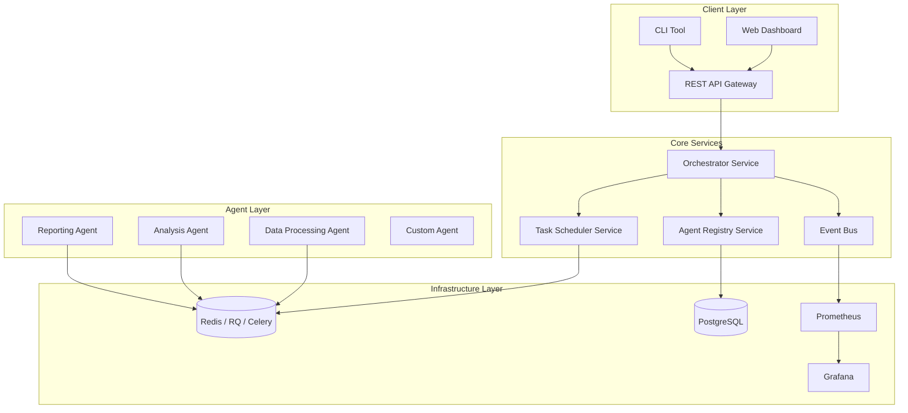
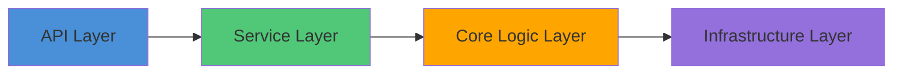

# Multi-Agent Orchestration System - Advanced Architecture Design

## Overview
Enterprise-grade multi-agent orchestration system built on open-source foundations, following microservices architecture, with production-ready features and monitoring.

## 1. Architecture Design

### High-Level Architecture


### Layered Architecture


## 2. Technology Stack

| Component | Technology | Version | Reason |
|-----------|-----------|---------|--------|
| Backend Framework | FastAPI | 0.110+ | Modern async, auto-docs, Pydantic |
| Task Queue | RQ (Redis Queue) | 1.16+ | Simple, Redis-based, easy scaling |
| Message Broker | Redis | 7.0+ | Fast, in-memory, supports pub/sub |
| Database | PostgreSQL | 14+ | Relational, ACID, good for metadata |
| ORM | SQLAlchemy | 2.0+ | Powerful ORM with async support |
| Monitoring | Prometheus + Grafana | Latest | Industry standard |
| Logging | Structlog + ELK Stack | Latest | Structured logging |
| Configuration | Pydantic Settings | 2.0+ | Type-safe config management |
| Testing | pytest + pytest-asyncio | Latest | Modern testing framework |
| CLI | Typer | 0.12+ | Modern CLI with type hints |
| Web UI (optional) | React + TailwindCSS | Latest | Modern frontend (if needed) |

## 3. Core Improvements

### 3.1 Distributed Communication
- **Before**: In-memory message passing
- **After**: Redis-based pub/sub + RQ for task queue
- **Benefits**: Cross-process, cross-machine communication, persistence

### 3.2 Production-Grade Task Management
- **Before**: Simple task manager
- **After**: RQ-backed with retries, timeouts, priorities, dead-letter queues
- **Benefits**: Enterprise-grade reliability

### 3.3 Persistence
- **Before**: In-memory only
- **After**: PostgreSQL for metadata, Redis for state
- **Benefits**: Durability, audit trail, analytics

### 3.4 Observability
- **Before**: No monitoring
- **After**: Prometheus metrics, Grafana dashboards, structured logging
- **Benefits**: Production-ready debugging and monitoring

### 3.5 API-First Design
- **Before**: No API
- **After**: REST API with OpenAPI docs, SDK generation
- **Benefits**: Easy integration, language-agnostic

## 4. Directory Structure
```
/maos/
├── maos/
│   ├── __init__.py
│   ├── core/                    # Core abstractions
│   │   ├── __init__.py
│   │   ├── agent.py            # Agent base class (refactored)
│   │   ├── message.py          # Message definitions
│   │   └── event.py            # Event system
│   ├── services/               # Business services
│   │   ├── __init__.py
│   │   ├── orchestrator.py     # Orchestrator service
│   │   ├── registry.py         # Agent registry
│   │   └── scheduler.py        # Task scheduler
│   ├── infrastructure/         # Infrastructure layer
│   │   ├── __init__.py
│   │   ├── redis.py            # Redis integration
│   │   ├── database.py         # PostgreSQL/SQLAlchemy
│   │   └── monitoring.py       # Prometheus integration
│   ├── api/                    # API layer
│   │   ├── __init__.py
│   │   ├── main.py             # FastAPI app
│   │   └── routers/            # API routers
│   ├── agents/                 # Built-in agents
│   │   ├── __init__.py
│   │   ├── data_agent.py
│   │   ├── analysis_agent.py
│   │   └── reporting_agent.py
│   ├── cli/                    # CLI tools
│   │   ├── __init__.py
│   │   └── main.py
│   └── config/                 # Configuration
│       ├── __init__.py
│       └── settings.py
├── tests/
│   ├── unit/                   # Unit tests
│   ├── integration/            # Integration tests
│   └── system/                 # System tests
├── examples/                   # Examples
├── docs/                       # Documentation
├── requirements.txt
├── pyproject.toml
└── README.md
```
